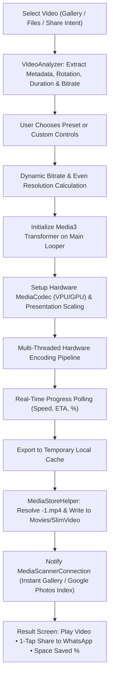

# 🎬 SlimVideo (स्लिमवीडियो)

<div align="center">


<br/>

[](https://github.com/slayergaming47786-cyber/slimvideo/releases)
[](https://github.com/slayergaming47786-cyber/slimvideo/actions)
[](https://github.com/slayergaming47786-cyber/slimvideo)
[](LICENSE)
[](#-privacy--security)

**Smart, high-performance, 100% on-device video compressor for Android & Web.**  
Reduces heavy **700+ MB** smartphone camera recordings to **~8–15 MB** (or **~4–5 MB** in Ultra Saver mode) with stunning visual clarity, zero battery drain, and complete privacy.

[📥 Download Latest APK (v2.2.0)](https://github.com/slayergaming47786-cyber/slimvideo/releases/latest) • [✨ Key Features](#-key-features) • [⚙️ Compression Presets](#-compression-presets) • [🏗️ Architecture](#%EF%B8%8F-architecture--tech-stack) • [🚀 Getting Started](#-getting-started)

</div>

---

## 🌟 Why SlimVideo?

Modern smartphone cameras record videos at extremely bloated bitrates (often 40–80 Mbps). A short 4-minute recording easily reaches **700 MB – 1 GB**, making it painful to send over WhatsApp, upload to social media, or store on limited phone storage.

Traditional compressors either:
1. **Upload your video to cloud servers** (slow, consumes mobile data, massive privacy hazard).
2. **Use slow software encoders (FFmpeg CPU)** that overheat the phone and take 10+ minutes.
3. **Destroy video quality** with muddy compression artifacts.

**SlimVideo solves this completely:**
- **100% Offline & On-Device**: Zero bytes leave your phone. All encoding runs locally.
- **GPU / VPU Hardware Acceleration**: Uses Android's native `MediaCodec` and Google `Media3 Transformer` to harness Qualcomm Snapdragon Adreno / MediaTek MiraVision / Samsung Exynos dedicated silicon.
- **Direct Gallery Save**: Automatically registers output in Android MediaStore (`Movies/SlimVideo`), appearing instantly in Google Photos, Samsung Gallery, and WhatsApp.
- **Original-Based Clean Naming**: Exports as `<original_name>-1.mp4` with automated collision-proof numbering.

---

## ✨ Key Features

| Feature | Description |
| :--- | :--- |
| ⚡ **Hardware Acceleration** | Utilizes hardware MediaCodec (VPU/GPU) for 10x-15x faster encoding with minimum thermal load. |
| 🔒 **100% Offline & Private** | Zero telemetry, zero cloud transfer, zero account requirement. Works in airplane mode. |
| 📁 **Direct Gallery Auto-Save** | Saves to `Movies/SlimVideo` using Android MediaStore APIs. Automatically indexed for Google Photos & Gallery. |
| 🏷️ **Clean File Naming** | Preserves original filename: `video00987.mp4` ➔ `video00987-1.mp4` (auto-increments to `-2`, `-3` if already exists). |
| 📲 **1-Tap WhatsApp Share** | Built-in system share sheet integration to send compressed videos directly to WhatsApp, Telegram, Gmail, etc. |
| 📥 **Share-To Receiver** | Send any 700+ MB video directly from your phone gallery to SlimVideo using the Android system Share menu. |
| 🎯 **Target Size Slider** | Set an exact target output size in megabytes (e.g. exactly 10 MB or 15 MB) and the math engine adapts bitrates automatically. |
| ⚙️ **Full Custom Mode** | Total manual control over Resolution (Original to 480p), Video Bitrate (100–4000 kbps), FPS (24/30/60), and Audio Bitrate. |
| 📊 **Real-Time Size Estimator** | Instantly calculates expected output size and space saved % as you drag sliders or change presets. |
| 🛡️ **Sensor Track Bypassing** | Automatically strips smartphone camera gyro, sensor telemetry, and vendor tracks to prevent transcode errors. |

---

## ⚙️ Compression Presets

SlimVideo provides a full spectrum of presets tailored for different use cases:

```
[ Ultra Saver ] ────── [ Balanced ] ────── [ Smart Auto ] ────── [ High Quality ] ────── [ Custom ]
   ~4-5 MB                 ~10-14 MB           ~10-12 MB             ~28-32 MB              Manual
 (480p / 24fps)         (720p / 30fps)      (720p / 30fps)        (1080p / 30fps)       (Any Bitrate)
```

| Preset | Target Resolution | Video Bitrate | Audio Bitrate | Typical Output (4 min video) | Best For |
| :--- | :--- | :--- | :--- | :--- | :--- |
| ⚡ **Smart Auto** *(Default)* | 720p HD (`1280×720`) | ~320 kbps | 64 kbps AAC | **~10–12 MB** *(~98% saved)* | Daily WhatsApp sharing, balance of crispness & low size |
| 📉 **Ultra Space Saver** | 480p (`854×480`) | ~140 kbps | 44 kbps AAC | **~4–5 MB** *(~99% saved)* | Archival, limited storage, slow network transfers |
| ⚖️ **Balanced** | 720p HD (`1280×720`) | ~380 kbps | 64 kbps AAC | **~12–14 MB** | General social sharing & high clarity playback |
| ⭐ **High Quality** | 1080p FHD (`1920×1080`)| ~1,000 kbps | 96 kbps AAC | **~28–32 MB** | TV playback, YouTube, retaining fine textures |
| 🎯 **Target Size (Slider)** | Adaptive (480p–1080p)| Calculated mathematically | 48–64 kbps | **User defined (e.g. 10 MB)** | Strict upload limits (email attachments, Discord) |
| ⚙️ **Custom Settings** | Original, 1080p, 720p, 540p, 480p | 100 kbps – 4000 kbps | 48, 64, 96, 128 kbps | Real-time dynamic calculation | Power users requiring specific specifications |

---

## 📐 The Compression Math Engine

SlimVideo calculates target parameters adaptively based on video duration ($D$) in seconds and requested target size ($S$) in bytes:

$$R_{\text{total}} = \frac{S \times 8}{D} \quad (\text{bits per second})$$

$$R_{\text{audio}} = \begin{cases} 
64{,}000 \text{ bps} & \text{if } R_{\text{total}} > 350{,}000 \\ 
44{,}000 \text{ bps} & \text{otherwise} 
\end{cases}$$

$$R_{\text{video}} = \max(80{,}000, R_{\text{total}} - R_{\text{audio}})$$

$$\text{Estimated Bytes} = \left(\frac{(R_{\text{video}} + R_{\text{audio}}) \times D}{8}\right) \times 1.02 \quad (\text{includes 2\% MP4 container overhead})$$

Dimension scaling preserves strict aspect ratio while aligning width and height to **even numbers** ($\text{multiple of } 2$) required by hardware AVC/H.264 encoders:

$$\text{even}(x) = x - (x \bmod 2)$$

---

## 🏗️ Architecture & Tech Stack

SlimVideo is built as a dual-platform project with a **pure native Android application** as the primary high-performance client, and a **modern web/PWA client**.

### Native Android Stack (`android/`)
```
android/app/src/main/
├── java/com/slimvideo/app/
│   ├── MainActivity.kt               # Entry point, Edge-to-Edge UI, Share Intent handling
│   ├── MainViewModel.kt              # MVI State machine (Idle, Analyzing, Ready, Compressing, Completed, Error)
│   ├── engine/
│   │   └── VideoCompressorEngine.kt  # Media3 Transformer + MediaCodec hardware acceleration pipeline
│   ├── model/
│   │   └── VideoModels.kt            # Metadata, Presets, Configs, Progress, Results data classes
│   ├── ui/
│   │   ├── components/               # Header, Dropzone, VideoInfoCard, CompressionControls, CompressingDialog, ResultCard
│   │   └── theme/                    # Deep space dark palette, glowing accents, typography
│   └── utils/
│       ├── MediaStoreHelper.kt       # Scoped Storage gallery writer (<original_name>-1.mp4) & FileProvider share
│       └── VideoAnalyzer.kt          # MediaMetadataRetriever parser & bitrate math engine
```

- **Language**: Kotlin 2.0.21
- **UI Toolkit**: Jetpack Compose 1.7 with Material 3
- **Video Engine**: Google AndroidX Media3 Transformer (`androidx.media3:media3-transformer:1.5.0`) & Media3 Effects (`androidx.media3:media3-effect:1.5.0`)
- **Hardware Integration**: Android MediaCodec via `DefaultEncoderFactory` (`VideoEncoderSettings`)
- **Image / Thumbnail Loading**: Coil Compose 2.7 with `VideoFrameDecoder`
- **Asynchronous Architecture**: Kotlin Coroutines (`Dispatchers.Main` for Transformer looper, `Dispatchers.IO` for MediaStore)

### Web / PWA Stack (`src/`)
- **Framework**: React 19 + TypeScript 5.7
- **Bundler**: Vite 8 (with `@vitejs/plugin-react-swc`)
- **Styling**: Tailwind CSS 4
- **Encoding Engine**: WebCodecs API via `mediabunny` (Client-side hardware MP4/WebM transcoding)
- **Offline Assets**: Service Worker (`public/sw.js`) + Web App Manifest (`public/manifest.json`)

---

## 🔄 Compression Pipeline Flow



---

## 📥 Download & Installation

### Android APK
1. Download the latest release APK from [GitHub Releases](https://github.com/slayergaming47786-cyber/slimvideo/releases/latest).
2. On your Android phone, tap the downloaded `.apk` file.
3. If prompted, allow **"Install unknown apps"** for your browser/file manager.
4. Open **SlimVideo** and select any large camera video to compress!

### Web Application / PWA
The web version runs locally or on any static host:
```bash
npm install
npm run dev
```
Open `http://localhost:5173` in Brave, Chrome, or mobile browser. Tap **"Install App"** in the browser menu to install it as an offline PWA.

---

## 🛠️ Building from Source

### Prerequisites
- **JDK**: Java 21 (Eclipse Temurin recommended)
- **Android SDK**: Compile SDK 35, Build-Tools 35.0.0
- **Node.js**: v22+ (for web client)
- **Git**

### Build Android APK Locally
```bash
# Clone the repository
git clone https://github.com/slayergaming47786-cyber/slimvideo.git
cd slimvideo/android

# Build Debug APK
./gradlew assembleDebug

# Output location:
# android/app/build/outputs/apk/debug/app-debug.apk
```

### GitHub Actions CI/CD
Every commit pushed to `main` triggers `.github/workflows/build-apk.yml`, automatically compiling the native APK on an `ubuntu-latest` runner and publishing `SlimVideo-Native-APK` as a downloadable artifact.

---

## 🔒 Privacy & Security

- **0% Data Upload**: SlimVideo has no backend servers, no analytics scripts, and no crash reporters.
- **Flight Mode Ready**: The app functions identically whether your phone is online or completely offline.
- **Scoped Storage Compliant**: Uses Android's official MediaStore APIs without requesting full device storage access on Android 10+.

---

## 📄 License

This project is licensed under the **MIT License**. Feel free to use, modify, and distribute as needed.

---

<div align="center">
<b>Crafted with ❤️ for fast, offline, and privacy-respecting video compression.</b>
</div>
